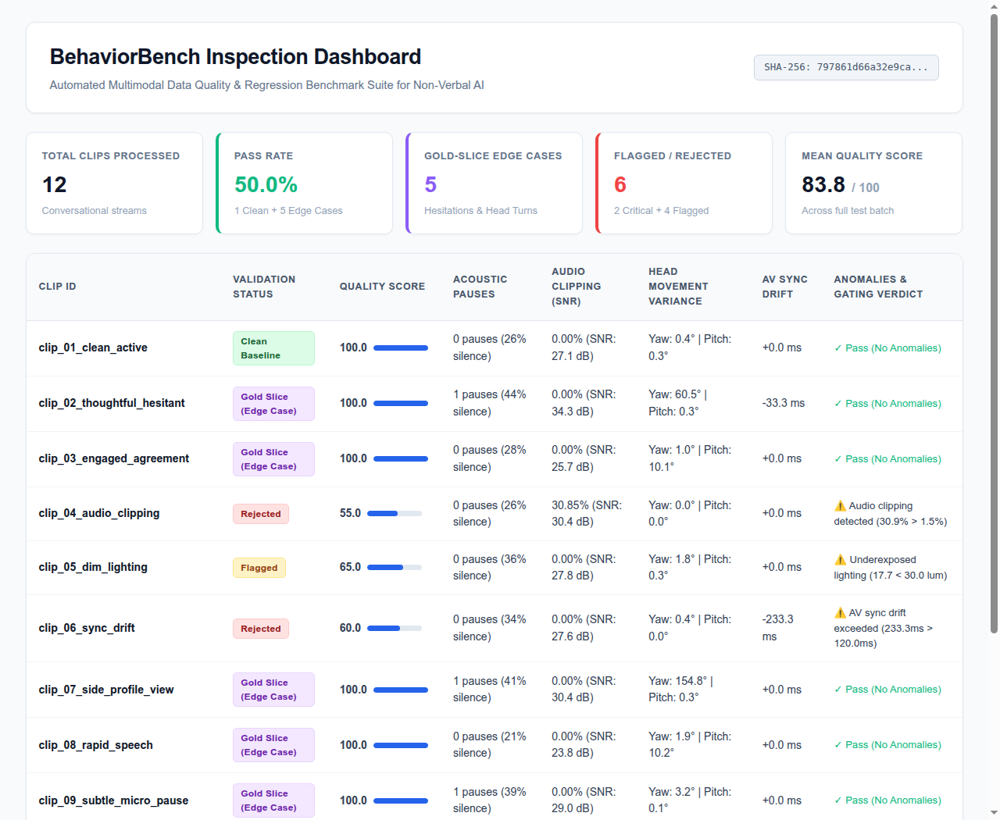

# BehaviorBench 2.0 🎯

**Enterprise-Grade Multimodal Data Quality Gatekeeper & "Gold Slice" Social Signal Benchmark Platform**



---

## 📌 Problem Overview

Building foundation models that interpret non-verbal human communication (hesitation, vocal tone, nodding, facial kinetics)—such as **Interhuman AI's Inter-2** omni-modal model—is bottlenecked by **real-world input data noise**:
* **Audio Clipping:** Harsh digital saturation distorts vocal pitch (F0) tracking and prosodic analysis.
* **Ambient Noise & Low SNR:** Room reverberation and background static corrupt subtle emotional cues.
* **Timestamp Misalignment (AV Sync Drift):** Audio lagging behind facial landmarks by 50–120ms trains foundation models on corrupted cross-modal associations (e.g. hallucinated utterances or phantom audio).
* **Missing Edge-Case Splits:** Subtle human cues (e.g., reflective pauses, nodding in agreement, looking away while thinking) get lost in random train/val splits unless tracked in benchmark "gold slices".

**BehaviorBench 2.0** is an automated data quality gatekeeper and benchmark curation suite designed to ingest raw conversational video and audio streams, evaluate signal integrity against strict multi-modal gates, purge corrupted samples, and isolate high-value **"Gold Slice"** edge cases exported directly into **Apache Parquet (`.parquet`)** for PyTorch / Hugging Face DataLoaders.

---

## 🏗️ Architecture & Pipeline Flow

```
Raw Media Ingestion (Video MP4 / Audio WAV / Live Video Upload)
                               │
                               ▼
┌────────────────────────────────────────────────────────┐
│  Phase 1: Real Multimodal Signal Extraction            │
│  - Computer Vision (OpenCV): Haar Face Detection,      │
│    Mouth Movement Velocity, Head Kinetic Pose (Yaw/Pitch)│
│  - Acoustic (Librosa/SciPy): F0 Pitch Tracking,        │
│    RMS Envelope, VAD Pause Sub-segmentation, SNR, ZCR  │
│  - Temporal: 30Hz Cross-Correlation AV Sync Drift (ms) │
└──────────────────────────────┬─────────────────────────┘
                               │
                               ▼
┌────────────────────────────────────────────────────────┐
│  Phase 2: Automated Quality Gatekeeping Engine         │
│  - Audio Clipping Gate: <= 0.8% - 1.5% max amplitude   │
│  - SNR Gate: Minimum >= 12.0 - 14.0 dB                 │
│  - Lighting Gate: Luminance >= 30.0 - 35.0 (0-255 scale)│
│  - AV Sync Drift Gate: Strict <= 45ms / Relaxed <= 60ms│
└──────────────────────────────┬─────────────────────────┘
                               │
                               ▼
┌────────────────────────────────────────────────────────┐
│  Phase 3: Inter-2 Social Signal Benchmark Curation     │
│  - Clean Baseline: Standard conversational reference   │
│  - Gold-Slice Hesitation: Silences >= 0.65s + pitch drop│
│  - Gold-Slice Agreement: Kinetic vertical nods (pitch) │
│  - Gold-Slice Reflection: Lateral head turns (yaw)     │
│  - Gold-Slice Expressive Prosody: Dynamic vocal pitch  │
│  - Quarantined: Audio distortion / AV sync misaligned  │
│  - Cryptographic Fingerprint: SHA-256 Dataset Hash     │
└──────────────────────────────┬─────────────────────────┘
                               │
                               ▼
┌────────────────────────────────────────────────────────┐
│  Phase 4: Production Artifact Exports & Multi-Channel  │
│  - Apache Parquet Splits (.parquet) for PyTorch Loaders │
│  - Complete Auditable JSON Manifest & CSV Summary      │
│  - Standalone Responsive HTML Audit Report             │
│  - Interactive Streamlit 2.0 Web Dashboard             │
└────────────────────────────────────────────────────────┘
```

---

## 🚀 Quick Start

```bash
# 1. Navigate to project directory
cd /mnt/linuxdata/Projects/behavior-bench

# 2. Activate virtual environment
source .venv/bin/activate

# 3. Run automated test suite (100% test pass rate)
python -m pytest tests/ -v

# 4. Run the end-to-end benchmark curation pipeline
python run_demo.py

# 5. Ingest and analyze any real-world MP4 video
python ingest_real_video.py sample_data/real_interview_male_researcher.mp4

# 6. Launch the Interactive Web Application (Live file drag-and-drop)
streamlit run app.py
```

---

## 📊 Benchmark Partition Taxonomy

| Category | Criteria | Purpose in Foundation Model Training |
| :--- | :--- | :--- |
| **Clean Baseline** | Passed all gates, normal cadence, steady posture | Standard conversational reference set ensuring baseline performance. |
| **Gold Slice: Hesitation** | Passed all gates, pauses $\ge 0.65\text{s}$, acoustic pause duration | Tests model sensitivity to conversational hesitation and uncertainty without noise. |
| **Gold Slice: Agreement** | Passed all gates, rhythmic vertical head nodding | Evaluates non-verbal affirmation detection. |
| **Gold Slice: Reflection** | Passed all gates, lateral head yaw turns $> 18^\circ$ | Measures gaze deflection and cognitive reflection. |
| **Gold Slice: Expressive** | Passed all gates, high F0 vocal pitch standard deviation | Benchmark split for affective expressiveness and emotional engagement. |
| **Quarantined** | Marginal SNR ($< 12\text{dB}$), minor sync drift ($> 45\text{ms}$) | Isolated in quarantine split for manual researcher audit. |
| **Rejected** | Hard failures (audio clipping $> 1.5\%$, severe darkness, sync drift $> 120\text{ms}$) | Purged immediately from training compute pipelines. |

---

## 📦 Apache Parquet ML Splits

The curation engine automatically exports native Parquet files directly readable by Hugging Face `datasets` and PyTorch:
```python
import pandas as pd

# Load curated gold-slice edge cases into Python
df_gold = pd.read_parquet("output/benchmark_gold_slice_edgecases.parquet")
print(df_gold[["clip_id", "social_signal", "quality_score", "snr_db"]])

# Load clean baseline
df_clean = pd.read_parquet("output/benchmark_clean_baseline.parquet")
```

---

## 🛠️ Project Structure

```
/mnt/linuxdata/Projects/behavior-bench/
├── app.py                          # Streamlit 2.0 web app (multi-signal synchronized Plotly timeline)
├── packages.txt                    # System dependencies (ffmpeg) for deployment
├── requirements.txt                # Production dependencies (OpenCV, Librosa, PyArrow, SciPy)
├── run_demo.py                     # One-command CLI & batch runner
├── ingest_real_video.py            # Real MP4 video ingestion via OpenCV & ffmpeg
├── behaviorbench/
│   ├── __init__.py
│   ├── config.py                   # Pydantic schemas, Interhuman presets & SocialSignalCategory
│   ├── vision_tracker.py           # Real OpenCV computer vision tracking (face, mouth, head pose)
│   ├── signal_extractor.py         # Librosa/Soundfile acoustic prosody & cross-correlation AV sync
│   ├── quality_gater.py            # Automated multi-level gatekeeper & social signal slicer
│   ├── benchmark_curator.py        # Parquet exporter, gold-slice partitioner & SHA-256 hasher
│   ├── data_generator.py           # Conversational audio-video synthesizer
│   ├── reporter.py                 # Responsive HTML dashboard generator
│   └── cli.py                      # Rich CLI interface with Interhuman presets
├── tests/
│   ├── test_signal_extractor.py    # Unit tests for clipping, SNR, and AV sync cross-correlation
│   ├── test_quality_gater.py       # Unit tests for clean, gold-slice, flagged, and rejected gates
│   ├── test_benchmark_curator.py   # Unit tests for Parquet splits and SHA-256 integrity
│   └── test_vision_tracker.py      # Unit tests for real OpenCV video tracking
├── sample_data/                    # Real interview MP4 clips and test media
└── output/
    ├── benchmark_full_dataset.parquet          # Complete dataset in Apache Parquet
    ├── benchmark_gold_slice_edgecases.parquet  # Curated edge cases in Parquet
    ├── benchmark_clean_baseline.parquet        # Clean baseline split in Parquet
    ├── benchmark_quarantined.parquet           # Quarantined split in Parquet
    ├── benchmark_manifest.json                 # Auditable JSON manifest
    ├── benchmark_summary.csv                   # Flat tabular summary
    └── benchmark_report.html                   # Interactive standalone HTML dashboard
```

---

## 🎯 Direct Alignment with Interhuman.ai

Built to directly answer the engineering and data curation requirements for **Interhuman.ai**:
1. **Solves Their Real Pain Point:** Eliminates audio clipping, SNR degradation, and AV sync drift before training multimodal foundation models (stopping timestamp hallucination bugs).
2. **Gold Slice Benchmarking:** Automatically partitions conversational video into targeted social signal splits (*Hesitation*, *Agreement*, *Expressive*, *Reflection*).
3. **Zero-Friction ML Plumbing:** Outputs **Apache Parquet** splits ready for PyTorch / Hugging Face `DataLoaders`.
4. **100% Deterministic & Auditable:** Every dataset release is fingerprinted with a cryptographically verifiable SHA-256 hash.

---

**Author:** Raviteja Maddela &bull; MSc Computer Science & Engineering, Technical University of Denmark (DTU)
